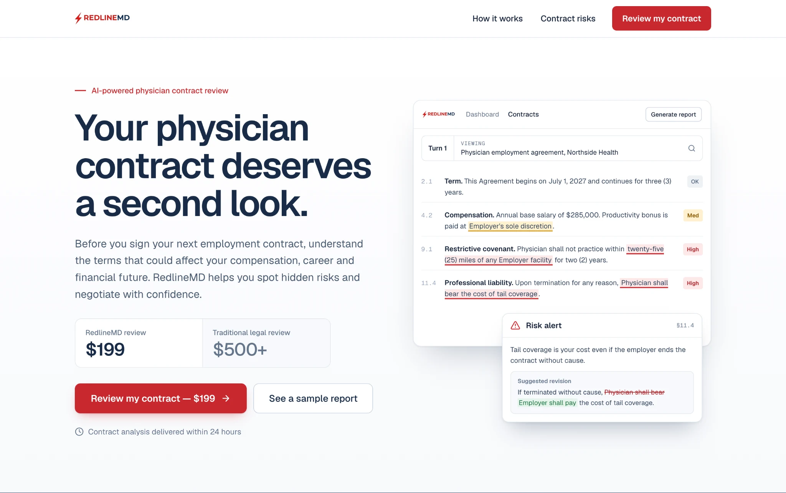
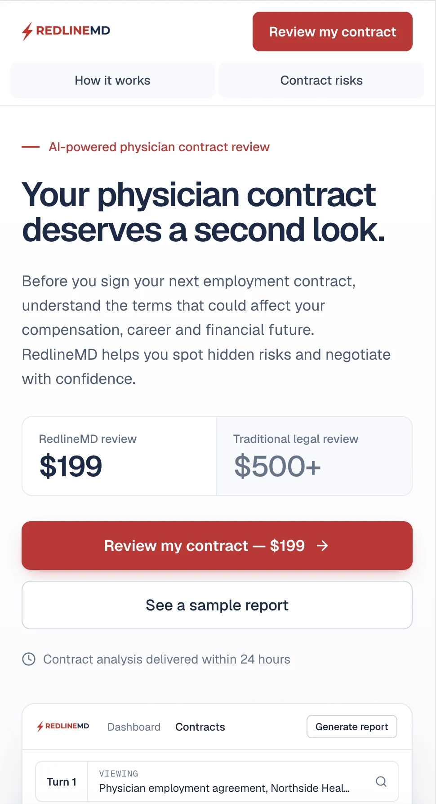
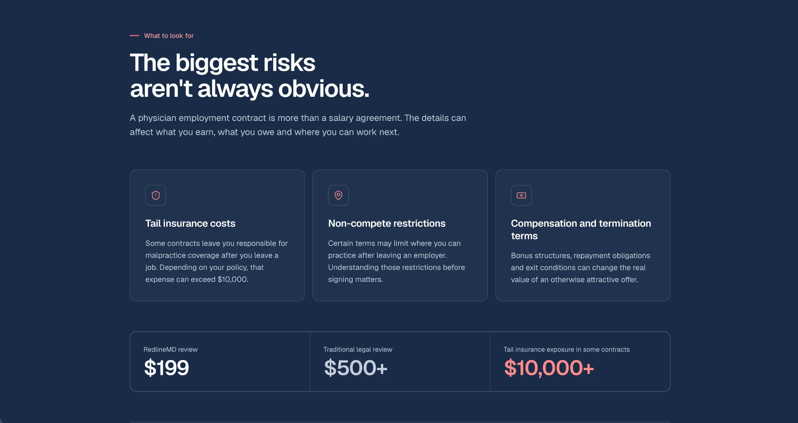
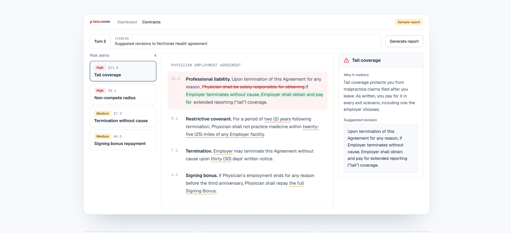

<div align="center">

**🇺🇸 English** · [🇧🇷 Português](./README.pt-BR.md) · [🇪🇸 Español](./README.es.md)

# RedlineMD — landing page redesign

### A conversion-focused, mobile-first design challenge

**UX/UI design · Responsive web implementation · Conversion strategy**

[](https://redlinemd-challenge.vercel.app/)

[](https://github.com/marcuscastrodev/redlinemd-challenge)
[](https://github.com/marcuscastrodev)

</div>

> **Independent design challenge.** This is a redesign concept created for a web designer assignment, not the official RedlineMD website. The decisions below are hypotheses informed by the provided brief, **not measured conversion improvements**.

## At a glance

| | |
| :--- | :--- |
| **Context** | Web designer assignment for Foundey |
| **Challenge** | Improve clarity, trust, and the mobile purchase journey for a physician contract-review service |
| **My focus** | UX strategy, visual direction, responsive interface, interaction design |
| **Deliverable** | Interactive landing-page concept and implementation packaged in `index.html` |
| **Business goal** | Make the offer understandable quickly and reduce friction toward contract review |
| **Status** | Published concept preview; no live A/B test or production checkout integration |
| **Preview URL** | [redlinemd-challenge.vercel.app](https://redlinemd-challenge.vercel.app/) (configured as repository homepage) |

## The challenge

According to the assignment brief, **35% of visits came from mobile devices while desktop accounted for over 90% of revenue**. This suggested a potential mobile conversion gap, but it did not establish its cause.

Visitors arriving through Google Ads needed immediate answers:

1. What does this service do for physicians?
2. How much does it cost, and why might it be worthwhile?
3. What happens after I submit a contract?
4. Can I trust the process?

The redesign focuses on answering those questions in a clear sequence, without inventing testimonials or performance claims.

## The design approach

```text
Search intent
     ↓
Clear offer + visible price
     ↓
Why contract review matters
     ↓
Interactive sample report
     ↓
Single primary next step
```

### 01 — Message match from the first screen

The hero uses language aligned with the search intent, “physician contract review.” Pricing is visible near the primary CTA rather than hidden deep in the page.

### 02 — One primary conversion action

The landing page prioritizes a single offer and consistent CTA destinations. The header provides only two in-page shortcuts, minimizing unnecessary navigation choices.

### 03 — Demonstrate value instead of claiming it

An interactive sample-report concept allows visitors to inspect contract-risk examples, redlined wording, and suggested changes. **The examples are illustrative**, not an actual legal review.

### 04 — Design specifically for mobile

The mobile concept includes:

- An early view of the offer, price, and CTA
- A conditional sticky price bar that avoids competing with the final conversion section
- Large navigation and action targets, designed at 44px or more
- A focused, one-alert-at-a-time sample-report reader
- Simplified hero content for smaller screens

### 05 — Reduce perceived upload friction

The final section includes an “Add your contract” interaction as part of the concept. **No contract is uploaded or processed by this demonstration.** Real file handling and checkout are outside the delivered scope.

## Visual system

| Element | Direction | Rationale |
| :--- | :--- | :--- |
| Primary navy | `#172B46` | A restrained, professional foundation |
| Brand red | `#D42A2F` | Reserved for CTAs and risk annotations |
| Typography | Geist and Geist Mono | Clear hierarchy and precise interface details |
| Layout | Alternating light and dark sections | Separate stages of the story visually |
| UI details | Subtle borders, restrained shadows, modest radii | Avoid decoration competing with the offer |
| Writing style | Sentence case | Readable, direct messaging |

The concept retains the original brand logo while making the interface more consistent.

## Accessibility and implementation considerations

The design rationale includes:

- Semantic section and content structure
- Visible keyboard focus indicators
- Reduced-motion preferences
- Attention to text contrast
- Mobile-friendly targets and responsive layout
- Page title, description, and Open Graph metadata

These are **design and implementation intentions**, not a claim of a completed accessibility certification or third-party audit.

## Preview and screenshots

**[Open the Vercel preview](https://redlinemd-challenge.vercel.app/)**. This URL is configured in the GitHub repository metadata; its runtime availability has not been independently verified in this review.

### Screenshot walkthrough

#### 01 — Desktop hero

The desktop landing page places the value proposition, price comparison, primary action, and product preview within the opening experience.



#### 02 — Mobile hero

The mobile layout adapts navigation and keeps the offer, price, and calls to action prominent on a smaller screen.



#### 03 — Contract risks

An educational section explains key contract risks through concise cards, reinforcing the rationale for reviewing an agreement.



#### 04 — Interactive sample report

A sample report concept pairs flagged clauses with risk levels, explanations, and illustrative suggested revisions.



*These are actual screenshots of the design concept, not evidence of production functionality, legal advice, or conversion results.*

## Project files and how to view

This repository contains an exported, self-contained HTML presentation in [`index.html`](./index.html). It uses an embedded bundler/runtime rather than a conventional, easily editable source tree.

To review it locally:

1. Clone or download this repository.
2. Open `index.html` in a modern browser with JavaScript enabled.
3. Explore the responsive experience and interactive concept.

**Note:** Because the delivered file is a packaged HTML export, this repository should not be interpreted as the original component-level source code. A maintainable, unbundled source version would be a separate improvement.

## What remains unvalidated

- **Actual conversion impact:** requires analytics and controlled A/B testing.
- **Delivery-time language:** the brief used conflicting “instant” and “within 24 hours” references.
- **Checkout and upload:** need real production endpoints and privacy safeguards.
- **Sample-report accuracy:** requires approved real-world examples.
- **Accessibility:** needs a full manual and automated test pass across browsers and devices.

## Next iteration

- [x] Add authentic desktop, mobile, contract-risk, and sample-report screenshots
- [x] Document the public preview URL configured in repository settings
- [ ] Independently validate that the Vercel preview opens and works
- [ ] Publish an editable source version if available
- [ ] Run cross-device and accessibility checks
- [ ] Test hypotheses with real user and conversion data, if the product team permits

---

<div align="center">

**Designed and documented by [Marcus Castro](https://github.com/marcuscastrodev)**

*Building useful digital experiences where design, engineering, and business strategy meet.*

</div>
